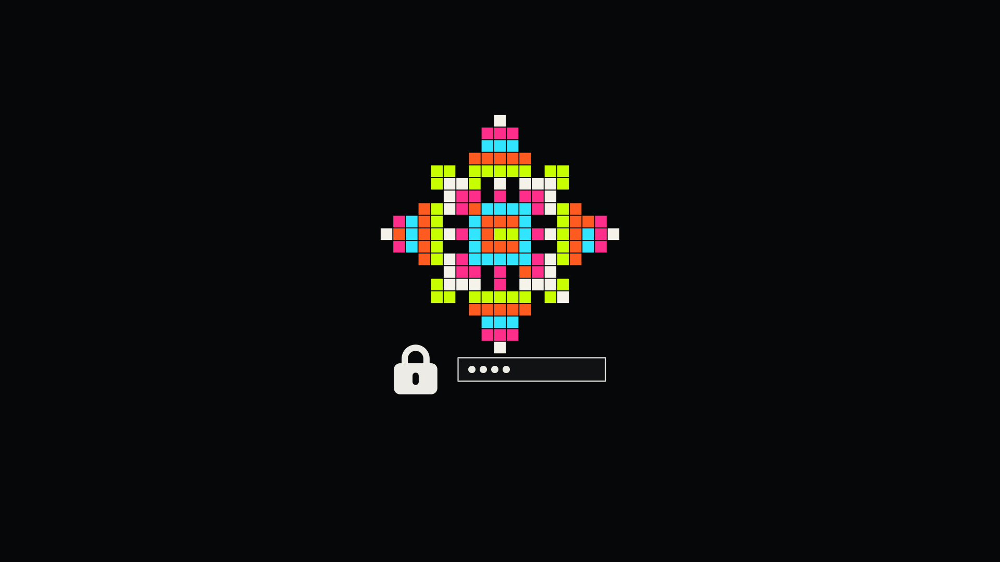

# Neon Foundry

An [Omarchy](https://omarchy.org/) theme built from the palette and the pixel-art
cast of [gulay.io](https://gulay.io) — nine workers, a flying saucer, a black
cat, a lamb, a devil, a snake and a handful of beetles — with gradient window
borders, six wallpapers, and four animated unlock screens.


## Install

```bash
omarchy theme install https://github.com/egulay/neon-foundry
```

That gets you the palette, the gradient borders and the wallpapers. The
animated unlock screens are a shell plugin and need one more step, so for the
whole thing clone and run the installer instead:

```bash
git clone https://github.com/egulay/neon-foundry
cd neon-foundry
./install.sh
```

`install.sh` links the repo into `~/.config/omarchy/themes/neon-foundry`, so
editing it here updates the installed theme in place. Options:
`--theme-only` (skip the unlock screens), `--no-apply` (install without
switching). `./uninstall.sh` reverses it and restores the stock unlock screen.

## The palette

The six foundational colours are the site's CSS custom properties, converted
from oklch to sRGB. The accents are the colours its sprites are painted in.

| Role | Site token | Hex |
|------|-----------|-----|
| Background | `--bg` | `#060709` |
| Raised background | `--bg-raised` | `#0e0f12` |
| Foreground | `--fg` | `#edebe5` |
| Muted foreground | `--fg-muted` | `#8f9298` |
| Lines | `--line` | `#27292d` |
| Accent | `--accent` | `#baf700` |
| Links | `--link` | `#44e7ef` |

Sprite palette: `#c8ff00` acid · `#ff5a1f` orange · `#31e5ff` cyan ·
`#ff2e8b` magenta · `#f5f2ea` cream. Terminal red is the devil's `#ff3b3b`,
yellow the cat's halo gold `#f2c14e`, blue the lamb's aura `#a8ecff`.

## Gradient borders

Declared in `colors.toml`, not in `hyprland.lua`:

```toml
hyprland_active_border = "rgba(c8ff00ee) rgba(31e5ffee) rgba(ff2e8bee) 45deg"
```

This matters. Omarchy strips every `.lua` from a theme installed from a git
repo — a theme's `hyprland.lua` is loaded at login, so it is not allowed to
ship code — and regenerates it from `colors.toml`. Putting the gradient in the
palette is the form that survives `omarchy theme install`. The same value feeds
the shell, which is what puts the gradient on the bar's popups and on the lock
screen's password field.

`hyprland.lua` is still here for the linked install, where it is kept. It adds
only what the template cannot express: an acid-green glow under the focused
window.

## Wallpapers

Six, in `backgrounds/`, generated at 2880×1800. Cycle with
`omarchy theme bg next`.

| File | Scene |
|------|-------|
| `01-quarry.png` | Stock on the left, lattice rising right, the crew hauling between them |
| `02-abduction.png` | The saucer has a beetle off the ground; the rest scatter |
| `03-crew.png` | All nine, mid-shift, across three lanes |
| `04-lattice.png` | The finished snowflake, centred and lit |
| `05-patrol.png` | The snake working the lines, a wormhole open at either end |
| `06-off-shift.png` | The cat, the lamb and the devil, each in their own light |

They are generated, not hand-drawn — `tools/gen_backgrounds.py` renders the
same sprite matrices the site animates:

```bash
python3 -I tools/gen_backgrounds.py                 # all six, native size
python3 -I tools/gen_backgrounds.py --size 3840x2160 --seed 7
python3 -I tools/gen_backgrounds.py --only 04-lattice
```

`--seed` changes the snowflake and the scatter; every flake is a fresh draw
from the same generator the site uses — one arm, mirrored through the eight
symmetries of the square.

`tools/` has no third-party dependencies: `canvas.py` is a small RGB buffer and
a PNG writer, because Pillow is not installed on a stock Omarchy box and every
shape here is an axis-aligned fill. ImageMagick, which Omarchy already ships,
lays the captions on afterwards.

## Unlock screens



Four scenes, drawn at random each time the screen locks:

| | Scene |
|---|---|
| 0 | **Crew** — the crew hauling blocks along a lane near the foot of the screen |
| 1 | **Abduction** — the saucer crossing with its beam down, beetles bolting below |
| 2 | **Menagerie** — the cat crossing and settling, the lamb grazing, the devil ambling |
| 3 | **Patrol** — the snake working the grid, a wormhole turning at either end |

No logo, no clock, no user card — just the password field, as asked for. To pin
one scene instead of a random draw, set `variant` on the `FoundryScene` in
`~/.config/omarchy/plugins/<user>.lock/LockView.qml`:

```qml
FoundryScene {
    anchors.fill: parent
    variant: 2          // always the menagerie
    active: root.loadBackground
}
```

### How it works, and what is deliberately untouched

Omarchy's lock screen is **not hyprlock** — it is the Quickshell plugin
`omarchy.lock`. (The `unlock.png` that stock themes still ship is a dead
legacy asset; nothing reads it.) `install.sh` clones that plugin to
`~/.config/omarchy/plugins/<user>.lock` and replaces one file, `LockView.qml`,
between two marked comment blocks.

`Service.qml` — the PAM flows, the password and fingerprint handling — is left
byte-identical to Omarchy's. Authentication is not somewhere to be clever for
the sake of a wallpaper. The scene loader also swallows its own errors: if a
scene ever fails to load, the lock screen still comes up with its field.

The scene is only built while the lock is actually up
(`active: root.loadBackground`, which the service binds to `locked`).

It does **not** stop when the display blanks. Omarchy turns the backlight off
five seconds after locking (`idleBlankTimer` in `Service.qml`, which runs
`omarchy-brightness-display off`), but that only darkens the panel — the
compositor carries on, and so do these animations. The cost is a few dozen
animated rectangles, not a repainting canvas, so it is small; it is not zero.
To make the blank delay longer, raise that `interval` in your own clone's
`Service.qml` — at the price of diverging from the stock service.

If you edit a scene by hand, run `omarchy restart shell` afterwards. Saving a
file under `~/.config/omarchy/plugins/` reloads the plugin's service code, but
the `LockView` the shell already built stays cached: the lock screen goes on
rendering the previous view and reports no error at all. `install.sh` restarts
the shell for this reason.

If Omarchy's own `LockView.qml` gains features, re-clone it and re-apply that
one block rather than keeping this copy frozen.

## Layout

```
colors.toml          the palette, and the gradient borders
hyprland.lua         focused-window glow (linked installs only)
icons.theme          Yaru-olive
chromium.theme       6,7,9
backgrounds/         six wallpapers
preview.png          theme picker
preview-unlock.png   lock screen preview
lock/                the unlock screens
  LockView.qml       stock view + one Neon Foundry block
  FoundryScene.qml   picks a scene at random
  FoundryPixel.qml   one pixel-art character
  FoundryGrid.qml    the grid they move on
  FoundrySprites.js  every sprite matrix, from the site
  Scene*.qml         the four scenes
tools/               wallpaper generator
```

`btop.theme`, `neovim.lua`, the terminal configs and the rest are not shipped
on purpose: Omarchy generates them from `colors.toml`, and a file shipped here
would win over a template that gets fixed upstream.

## Credit

Palette, characters and the coloured snowflake: the hero canvas of
[gulay.io](https://gulay.io). Built for Omarchy.
